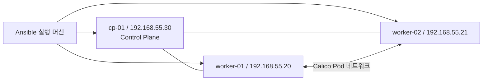

# kubeadm 기반 Kubernetes 클러스터 자동 구성

Ubuntu 서버 3대에 Kubernetes 클러스터를 구성하는 Ansible 프로젝트입니다.
노드 준비, Control Plane 초기화, Calico 설치, Worker 가입, 상태 검증을
각 플레이북으로 분리했습니다. 포트폴리오에서는 단계별 책임과 실제 실행할
명령을 함께 확인할 수 있습니다.

## 구성



| 항목 | 설정 |
| --- | --- |
| 토폴로지 | Control Plane 1대, Worker 2대 |
| 운영체제 | Ubuntu, Calico 요구사항을 충족하는 Linux 커널 5.10 이상 |
| Kubernetes | v1.35 계열, init 시 설치된 kubeadm의 정확한 버전 사용 |
| 컨테이너 런타임 | containerd, systemd cgroup driver |
| CNI | Calico v3.33.0 공식 매니페스트, SHA-256 검증 |
| Calico 네트워크 | 기본 BGP + IP-in-IP, kube-proxy 유지 |
| Pod CIDR | `10.244.0.0/16` |
| Service CIDR | `10.96.0.0/12` |
| API endpoint | `192.168.55.30:6443` |

고정된 단일 CP 실습 구성이며 HA 구성이나 버전 업그레이드 도구가 아닙니다.
Calico 기본 예제에 자주 쓰이는 `192.168.0.0/16`은 이 환경의 노드 주소와
겹치므로 사용하지 않습니다. 노드 IP는 inventory의 `ansible_host`를 사용하고,
Calico도 Kubernetes InternalIP를 참조하도록 설정합니다.

## 파일과 실행 순서

```text
site.yml
  ├─ prepare_cka.yml          전체 노드의 OS·런타임·패키지 준비
  ├─ init_control_plane.yml   cp-01에서 kubeadm init 및 kubeconfig 준비
  ├─ install_cni.yml          Calico 매니페스트 다운로드·설정·적용
  ├─ join_workers.yml         Worker별 kubeadm join
  └─ verify_cluster.yml       전체 노드와 시스템 구성요소 상태 확인
```

- `inventory.ini`: 노드 주소와 CP/Worker 그룹. `k8s_cluster`는 CP와 Worker 그룹을 포함합니다.
- `cluster_vars.yml`: Kubernetes, 네트워크, Calico의 공통 설정. 각 플레이북의 `vars_files`에서 명시적으로 읽습니다.
- `templates/kubeadm-init.yaml.j2`: kubeadm `InitConfiguration`, `ClusterConfiguration`, kubelet 설정.
- `templates/kubeadm-join.yaml.j2`: 가입 토큰, CA 공개키 해시, 노드 IP를 담는 `JoinConfiguration`.
- `templates/calico-kustomization.yaml.j2`: 공식 Calico 매니페스트에 Pod CIDR과 IP 탐지 설정을 적용하는 Kustomize 패치.

Ansible 플레이북은 실행 머신에서 `ansible-playbook`으로 실행합니다.
각 플레이북의 아래 선언이 같은 디렉터리에 있는 공통 변수 파일을 읽습니다.

```yaml
vars_files:
  - "{{ playbook_dir }}/cluster_vars.yml"
```

`cluster_vars.yml`도 플레이북과 함께 보관해야 합니다. 노드 이름은 inventory의
호스트 이름(`cp-01`, `worker-01`, `worker-02`)을 그대로 사용합니다.
kubeadm 설정 파일은 대상 서버에서 렌더링되어 `kubeadm --config` 입력으로
사용됩니다. Calico 리소스는 CP의 `kubectl apply -k`로 API 서버에 등록되며,
DaemonSet이 각 노드에 CNI를 배포합니다.

첫 CP에는 `kubeadm init`만 실행합니다. `kubeadm join`은 Worker에서만 실행하며,
추가 CP 가입은 이 프로젝트의 범위에 포함하지 않습니다.

## 실행 전 준비

- 실행 머신: Ansible 및 `community.general` 컬렉션, 각 노드에 대한 SSH 접속.
- 대상 서버: Ubuntu, sudo 사용 가능, 서로 다른 호스트명과 고정 IP, cgroup v2.
- 노드 간 Kubernetes 통신 포트와 Calico의 TCP 179(BGP), IP 프로토콜 4(IP-in-IP) 허용.
- 패키지 저장소, GitHub Raw, Kubernetes·Calico 이미지 레지스트리에 대한 외부 통신.
- 다른 CNI가 설치되지 않은 노드. 기존 운영 클러스터를 재구성하거나 CNI를 교체하는 용도로 사용하지 않습니다.

Calico의 인터페이스·iptables 관리를 방해하는 NetworkManager/방화벽 설정은
환경에 맞게 사전에 조정해야 합니다. 플레이북은 방화벽을 임의로 끄지 않습니다.

```bash
ansible-galaxy collection install community.general

# 서버를 변경하지 않는 로컬 점검
ansible-inventory -i inventory.ini --graph
ansible-playbook -i inventory.ini site.yml --syntax-check
ansible-playbook -i inventory.ini site.yml --list-hosts

# 실제 클러스터 생성: 이 명령부터 대상 서버가 변경됩니다.
ansible-playbook -i inventory.ini site.yml
```

sudo 비밀번호가 필요한 환경에서는 마지막 명령에 `-K`를 붙입니다.
전체 구성에는 실행 중 생성되는 API와 가입 토큰이 필요하므로 `--check`를
지원하지 않습니다. 정적 검증에는 `--syntax-check`를 사용합니다.

단계별 실행도 가능합니다. 아래 순서를 유지합니다.

```bash
ansible-playbook -i inventory.ini prepare_cka.yml
ansible-playbook -i inventory.ini init_control_plane.yml
ansible-playbook -i inventory.ini install_cni.yml
ansible-playbook -i inventory.ini join_workers.yml
ansible-playbook -i inventory.ini verify_cluster.yml
```

## 재실행과 자격 증명 처리

- CP에 `admin.conf`가 있으면 init을 생략합니다.
- Worker에 `kubelet.conf`가 있으면 join을 생략합니다.
- 초기화·가입 전 환경 확인은 kubeadm 자체 preflight 검사를 사용합니다. `kubeadm reset`이나 etcd 삭제는 실행하지 않습니다.
- Worker 가입마다 유효기간 30분의 토큰을 만들고, 가입 시도 후 토큰을 폐기합니다.
- 토큰이 담긴 join 설정은 권한 `0600`으로 만들고 `always` 블록에서 삭제합니다. 토큰은 Ansible 로그에 출력하지 않습니다.
- Calico는 저장 디렉터리 생성, 공식 매니페스트 다운로드, Kustomize 설정 렌더링, `kubectl apply`의 네 작업으로 설치합니다.
- kubeadm과 Calico는 같은 `kubernetes_pod_subnet` 변수를 사용합니다. 기존 CNI 조회, 설치 마커, `diff` 단계는 사용하지 않습니다.
- Calico 리소스는 매번 apply하므로 Ansible에서는 해당 작업을 `changed`로 표시합니다. 노드 Ready와 Calico rollout 확인은 마지막 `verify_cluster.yml`에서 수행합니다.
- CP의 사용자 kubeconfig는 기존 파일이 없을 때만 설치합니다. 기존 kubeconfig를 덮어쓰지 않습니다.

고정된 Ubuntu·CP 1대·Worker 2대 구성을 전제로 OS, 노드 수, 패키지 버전의
별도 사전 검증은 생략했습니다. `pre_tasks` 구역 없이 필요한 상태 확인을
`tasks` 앞에 배치합니다. 기존 노드의 클러스터 소속이나 설정 변경을 포괄적으로
검사하는 도구는 아니므로 inventory와 공통 설정은 이 구성에 맞게 유지합니다.

초기화 도중 실패하면 원인을 확인하고 복구한 뒤 다시 실행해야 합니다.
이 플레이북은 기존 클러스터의 자동 복구나 업그레이드를 수행하지 않습니다.
Kubernetes 패키지는 설치 후 hold하지만 패치 버전까지 지정하지는 않으므로,
다른 날짜에 설치한 노드들의 kubeadm 버전이 다르면 Worker 가입 전에 맞춰야 합니다.

## 검증 범위와 포트폴리오 증빙

작성 시 로컬에서 아래 항목을 확인했습니다. 실제 서버에 플레이북을 적용한
통합 테스트 결과와는 구분합니다.

- Ansible 전체 플레이북 문법 및 CP 1대·Worker 2대의 inventory 해석.
- 실제 inventory 변수를 사용한 kubeadm·Calico 템플릿 렌더링.
- 공식 Calico 파일의 체크섬과 Kustomize 병합 결과 38개 리소스.
- CP/Worker의 노드 이름·주소, kubeadm/Calico Pod CIDR 일치 및 네트워크 대역 비중복.

`verify_cluster.yml`은 inventory에 있는 모든 노드가 `Ready`인지 확인하고,
Calico DaemonSet·컨트롤러, CoreDNS, kube-proxy의 rollout 완료를 기다립니다.
이 검사는 Pod 간 실제 통신이나 NetworkPolicy 동작을 완전히 검증하지 않습니다.

실제 배포 후 CP에서 아래 결과를 포트폴리오 실행 증빙으로 추가할 수 있습니다.
아래 명령의 성공 결과는 아직 이 저장소에서 확인한 것이 아닙니다.

```bash
sudo kubectl --kubeconfig=/etc/kubernetes/admin.conf get nodes -o wide
sudo kubectl --kubeconfig=/etc/kubernetes/admin.conf -n kube-system get pods -o wide

# DNS 질의 실습: 임시 Pod를 만들고 종료 시 삭제합니다.
sudo kubectl --kubeconfig=/etc/kubernetes/admin.conf run dns-check \
  --image=busybox:1.37.0 --restart=Never --rm -i \
  -- nslookup kubernetes.default.svc.cluster.local
```

기존 `deploy_argocd.yml`은 클러스터 생성 이후의 별도 단계입니다.
Vault·Helm 등 별도 전제 조건이 있으므로 `site.yml`에 포함하지 않았습니다.

## 참고 문서

- [kubeadm 클러스터 생성](https://kubernetes.io/docs/setup/production-environment/tools/kubeadm/create-cluster-kubeadm/)
- [kubeadm v1beta4 설정](https://kubernetes.io/docs/reference/config-api/kubeadm-config.v1beta4/)
- [Calico 온프레미스 설치 — Manifest 방식](https://docs.tigera.io/calico/latest/getting-started/kubernetes/self-managed-onprem/onpremises)
- [Calico 시스템 요구사항](https://docs.tigera.io/calico/latest/getting-started/kubernetes/requirements)

공식 문서는 일반적으로 Operator 설치를 권장합니다. 이 프로젝트는 소규모
실습 환경에서 적용되는 리소스와 설정을 직접 확인할 수 있도록 버전을 고정한
매니페스트 방식을 사용합니다.
